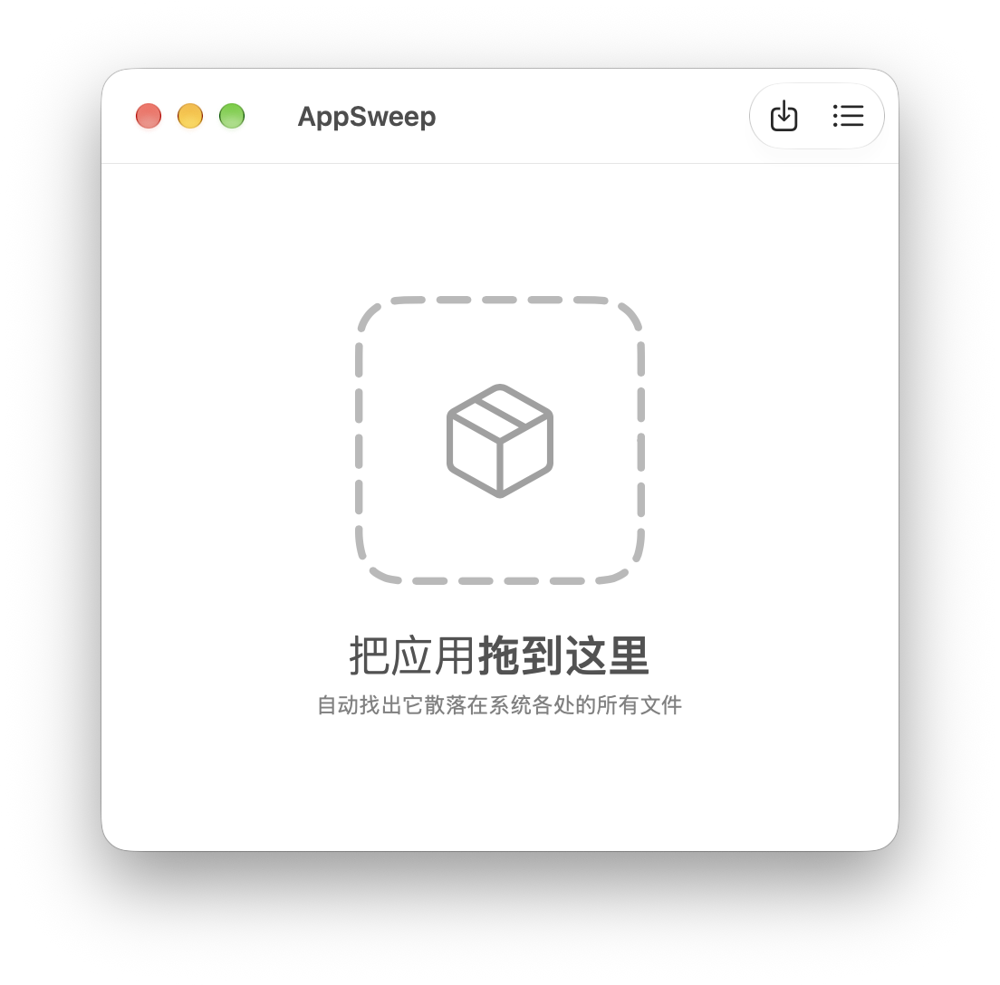
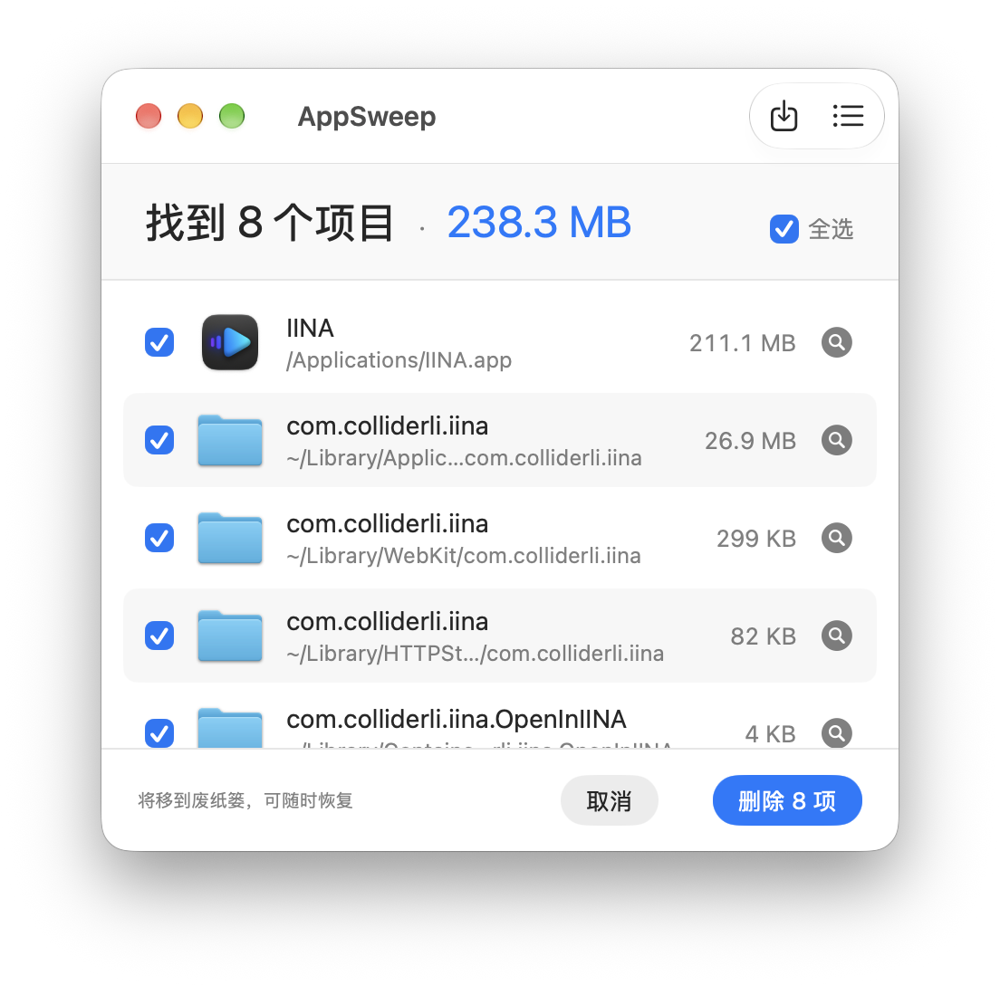

<p align="center">
  
</p>

<h1 align="center">AppSweep</h1>

<p align="center">
  <b>English</b> · <a href="README.zh-CN.md">简体中文</a>
</p>

<p align="center">
  A macOS app uninstaller. Drop an app into the window, and AppSweep finds every file it has left scattered across your system, so you can move them all to the Trash in one click.
</p>

<p align="center">
  <a href="../../releases/latest"></a>
  
  
</p>

## Screenshots

<table>
  <tr>
    <td align="center"><br>Drop an app in</td>
    <td align="center"><br>Review the related files, then remove them</td>
  </tr>
</table>

> The interface is currently in Simplified Chinese.

## Features

- Drop an `.app` onto the window or the Dock icon, or pick one from the list of installed apps
- Scans Application Support, Caches, Preferences, Containers, Group Containers, Logs, Saved Application State, WebKit, HTTPStorages, LaunchAgents/Daemons, PrivilegedHelperTools, installer receipts, crash reports and system temp caches
- Matches by bundle ID (including the IDs of embedded extensions, helpers and login items) and by app name
- Files go to the Trash, so nothing is lost for good; protected files ask for your administrator password
- Asks you to quit an app that is still running; built-in macOS apps are protected
- Resizable window
- Checks GitHub Releases for new versions and can install them and relaunch in one click (menu **AppSweep → 检查更新…** / Check for Updates)

## Install

Download `AppSweep-x.y.z.zip` from [Releases](../../releases), unzip it and drag it into Applications.

The app is not notarized by Apple. If macOS blocks it on first launch, right-click it and choose **Open**, or run:

```sh
xattr -cr /Applications/AppSweep.app
```

For the most complete results, add AppSweep under **System Settings → Privacy & Security → Full Disk Access**.

## Build

Requires the Xcode command line tools, macOS 14+ and Apple Silicon.

```sh
./build.sh   # produces build/AppSweep.app and build/AppSweep-<version>.zip
```

## Releasing a new version

1. Bump `CFBundleShortVersionString` in `Resources/Info.plist`
2. Run `./build.sh`
3. Run `gh release create v<version> build/AppSweep-<version>.zip --notes "Release notes"`

Installed copies check for the latest release at launch (at most once a day) and offer to update when a newer version is available.
