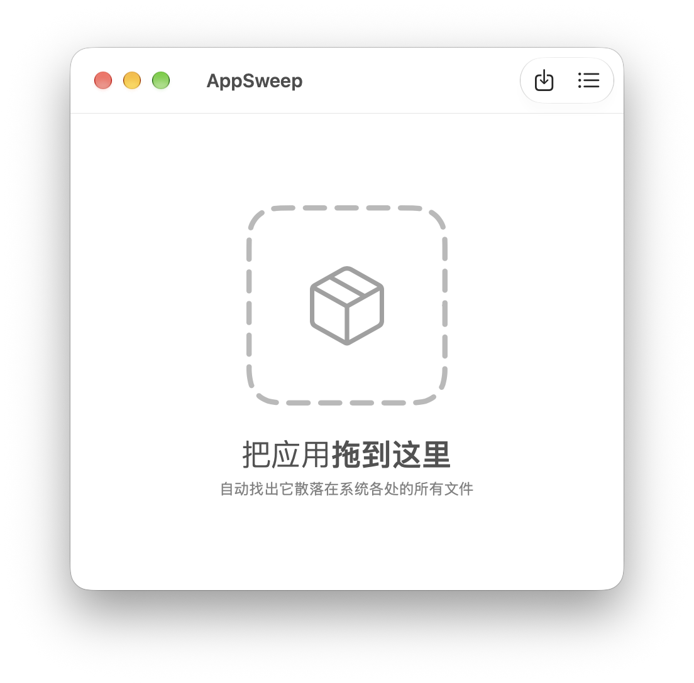
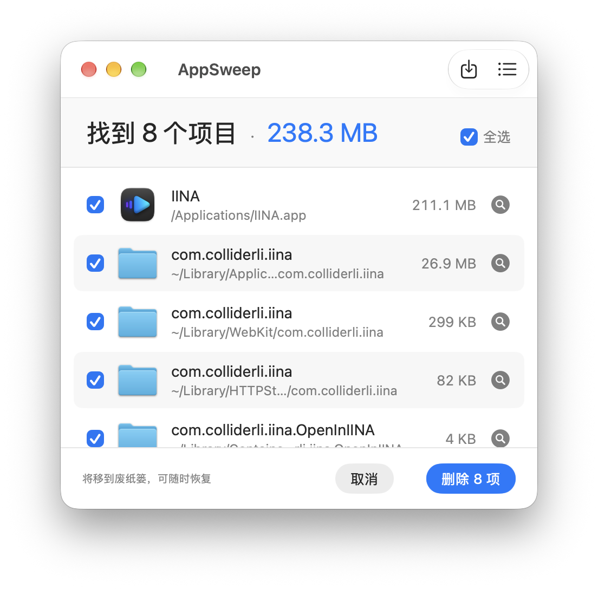

<p align="center">
  
</p>

<h1 align="center">AppSweep</h1>

<p align="center">
  <a href="README.md">English</a> · <b>简体中文</b>
</p>

<p align="center">
  一个 macOS 应用卸载工具：把 App 拖进窗口，自动找出它散落在系统各处的所有相关文件，勾选后一键移到废纸篓。
</p>

<p align="center">
  <a href="../../releases/latest"></a>
  
  
  <a href="LICENSE"></a>
  <a href="../../stargazers"></a>
</p>

## 截图

<table>
  <tr>
    <td align="center"><br>把应用拖进来</td>
    <td align="center"><br>列出所有相关文件，勾选后删除</td>
  </tr>
</table>

## 功能

- 拖拽 `.app` 到窗口或 Dock 图标，或从「已安装的应用」列表中选择
- 扫描 Application Support、Caches、Preferences、Containers、Group Containers、Logs、Saved Application State、WebKit、HTTPStorages、LaunchAgents/Daemons、PrivilegedHelperTools、安装收据、崩溃报告、系统临时缓存等位置
- 通过 Bundle ID（含内嵌扩展、Helper、登录项的 ID）和应用名精确匹配
- 删除即移到废纸篓，可恢复；需要权限的文件会请求管理员密码
- 运行中的 App 会先提示退出；macOS 系统自带应用受保护
- 窗口可自由缩放
- 自动检查 GitHub Releases 上的新版本，可一键安装并重启（菜单「AppSweep → 检查更新…」）

## 安装

从 [Releases](../../releases) 下载 `AppSweep-x.y.z.zip`，解压后拖到「应用程序」。

应用未经 Apple 公证，首次打开如被拦截，请右键 →「打开」，或执行：

```sh
xattr -cr /Applications/AppSweep.app
```

建议在「系统设置 → 隐私与安全性 → 完全磁盘访问权限」中加入 AppSweep 以获得最完整的扫描结果。

## 构建

需要 Xcode 命令行工具，macOS 14+，Apple Silicon。

```sh
./build.sh   # 输出 build/AppSweep.app 和 build/AppSweep-<版本>.zip
```

## 发布新版本

1. 修改 `Resources/Info.plist` 中的 `CFBundleShortVersionString`
2. `./build.sh`
3. `gh release create v<版本> build/AppSweep-<版本>.zip --notes "更新说明"`

已安装的 App 启动时（每天最多一次）会检查最新 Release，发现新版本时提示更新。

## Star 增长趋势

<p align="center">
<a href="https://star-history.com/#245678000000/AppSweep&Date">
  <picture>
    <source media="(prefers-color-scheme: dark)" srcset="https://api.star-history.com/svg?repos=245678000000/AppSweep&type=Date&theme=dark">
    
  </picture>
</a>
</p>

## 开源协议

基于 [MIT](LICENSE) 协议开源 © 2026 Peng Xing。如果 AppSweep 对你有帮助，欢迎点个 ⭐ Star！
